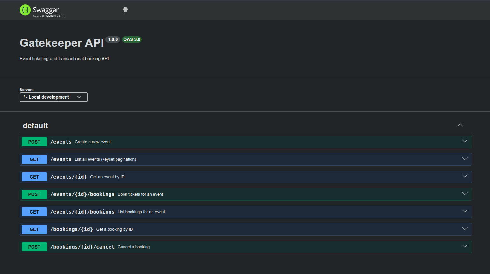
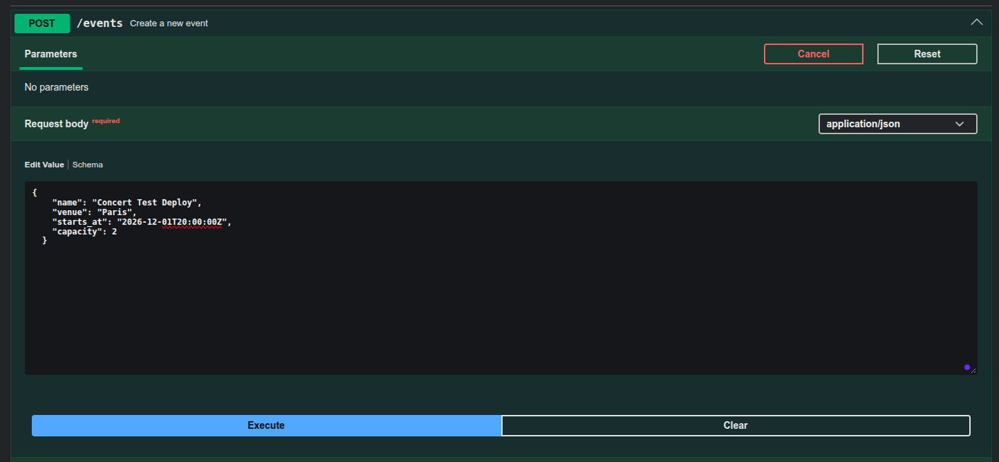
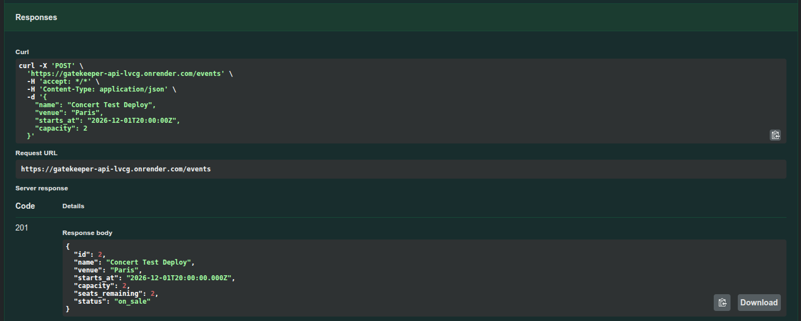
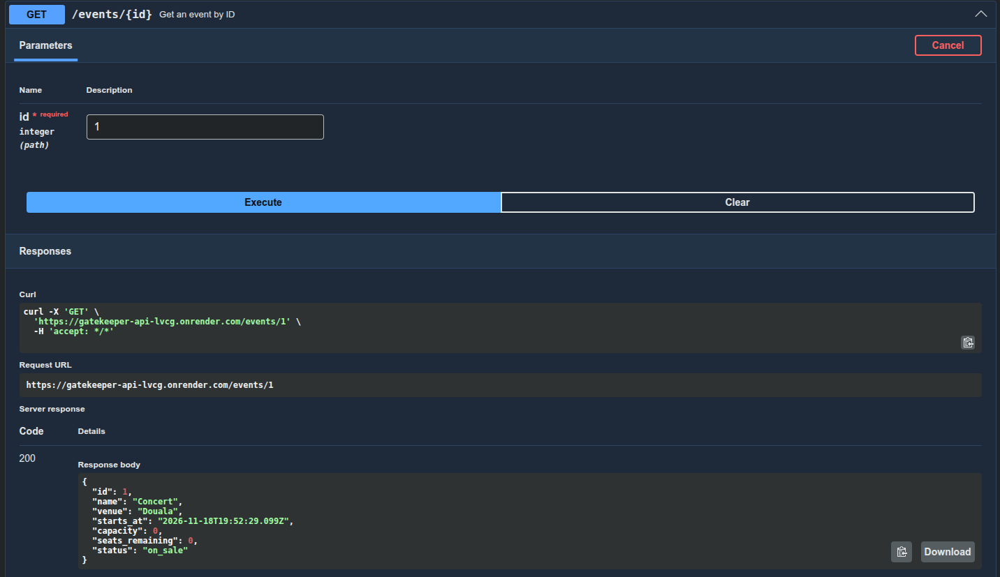

# 🎟️ Gatekeeper API - Event Ticketing & Transactional Booking

A fully functional event ticketing API built with **Node.js, Express, and PostgreSQL**. Organizers can create events with limited capacity, and customers can book tickets. The system guarantees that seats are never oversold, even under extreme concurrent load.

---

## 🎯 Project Goals

This project aims to:

- Build a **REST API** with correct HTTP semantics (400 / 404 / 409)
- Implement a **lossless transactional booking system** using conditional decrements
- Validate every input with **Zod**
- Write **parameterized SQL everywhere**
- Implement **keyset pagination** with cursors
- Test everything with **`node:test`** against a disposable test database
- Document the API with **OpenAPI 3.0.3** + Swagger UI at `/docs`

---

## 🚀 Key Features

### Create & Manage Events

- `POST /events` with `{ name, venue, starts_at, capacity }`
- Returns **201 Created** with `seats_remaining` initialized to `capacity`

### Transactional Booking (No Overselling)

- `POST /events/:id/bookings` with `{ customer_id, quantity }`
- **Atomic conditional decrement** guarantees two simultaneous requests can't both grab the last seat
- **201 Created** on success, **409 Conflict** if sold out
- **400 Bad Request** if the customer doesn't exist or quantity is invalid (e.g., > 10)

### Safe Cancellation & Rollback

- `POST /bookings/:id/cancel` returns **204 No Content**
- Restores seats to the event safely in a transaction
- **409 Conflict** if the booking is already cancelled
- **404 Not Found** for unknown bookings

### Keyset Pagination

- `GET /events?after=&limit=` and `GET /events/:id/bookings?after=&limit=`
- Returns `{ data, next_cursor }`
- Uses `id < $cursor ORDER BY id DESC` - **no OFFSET**

### OpenAPI & Swagger UI

- Complete OpenAPI 3.0.3 spec (`openapi.yaml`)
- Served interactively at **`GET /docs`**
- Try out every endpoint directly from the browser

### 💚 Health Check

- `GET /health` runs `SELECT 1` against the database
- **200** `{ status: "ok", database: "ok" }` when live
- **503** when the DB is unreachable

---

## Signature Feature: Lossless Transactional Booking

The core requirement of this project is to prevent overselling. Two users clicking "Book" on the last seat at the exact same millisecond must result in **exactly one success and one failure**.

This is achieved using a **single-statement atomic conditional decrement** inside a PostgreSQL transaction:

```sql
BEGIN;
UPDATE events
SET seats_remaining = seats_remaining - $qty
WHERE id = $id AND seats_remaining >= $qty AND status = 'on_sale';
-- rowCount = 0 -> throw 409 Conflict -> ROLLBACK
INSERT INTO bookings (event_id, customer_id, quantity) VALUES ($id, $cust, $qty);
COMMIT;
```

**Proof of correctness:**
The test `test/concurrency.test.js` fires two parallel requests (`Promise.all`) for the last available seat. The test asserts:

1. Exactly one request returns `201`.
2. The other returns `409`.
3. The final `seats_remaining` is exactly `0` (never negative).

---

## 📁 Project Structure

```text
gatekeeper-api/
├── .github/
│   └── workflows/
│       └── linter.yml
├── images/
├── scripts/
│   ├── db-setup.js
│   └── seed.js
├── src/
│   ├── app.js
│   ├── server.js
│   ├── config.js
│   ├── db.js
│   ├── db/
│   │   └── schema.sql
│   ├── middleware/
│   │   └── errorHandler.js
│   ├── routes/
│   │   ├── events.js
│   │   └── bookings.js
│   ├── schemas/
│   │   ├── eventSchemas.js
│   │   └── bookingSchemas.js
│   ├── services/
│   │   ├── eventService.js
│   │   └── bookingService.js
│   └── utils/
│       └── errors.js
├── test/
│   ├── setup.js
│   ├── helpers.js
│   ├── events.test.js
│   ├── bookings.test.js
│   ├── concurrency.test.js
│   └── security.test.js
├── .env.example
├── .nvmrc
├── .prettierrc.json
├── .sqlfluff
├── eslint.local.config.js
├── openapi.yaml
├── package.json
└── README.md
```

---

## 🌐 Live Demo

- **API URL**: [https://gatekeeper-api-lvcg.onrender.com](https://gatekeeper-api-lvcg.onrender.com)
- **Swagger UI**: [https://gatekeeper-api-lvcg.onrender.com/docs](https://gatekeeper-api-lvcg.onrender.com/docs)

> _Hosted on Render's free tier: the first request may take 30-60s (cold start)._

---

## 📸 Screenshots



### POST /events (Create)

|                Request                 |                  Response                   |
| :------------------------------------: | :-----------------------------------------: |
|  |  |

### GET /events/{id} (Fetch)



---

## 🚀 Getting Started (Local)

### Prerequisites

- Node.js ≥ 24.21.0 (`node --version`)
- PostgreSQL ≥ 15 (`pg_isready`)
- A database user with `CREATEDB` privilege

### Installation

```bash
# 1. Clone the repository
git clone https://github.com/mike2377/gatekeeper-api.git
cd gatekeeper-api

# 2. Install dependencies
npm install

# 3. Create the databases
createdb gatekeeper
createdb gatekeeper_test

# 4. Configure environment
cp .env.example .env
# Edit .env with your DATABASE_URL and TEST_DATABASE_URL

# 5. Apply schema and seed data
npm run db:setup
npm run seed

# 6. Start the development server
npm run dev
```

The API is available at `http://localhost:3000`.
Swagger UI: `http://localhost:3000/docs`

### Useful Scripts

| Command            | Description                             |
| ------------------ | --------------------------------------- |
| `npm run dev`      | Start server with `--watch`             |
| `npm start`        | Start server                            |
| `npm test`         | Run all tests against `gatekeeper_test` |
| `npm run lint`     | Run ESLint                              |
| `npm run db:setup` | Apply `schema.sql` to the DB            |
| `npm run seed`     | Insert demo customers and events        |

---

## 🧪 Testing

```bash
npm test
```

Runs `node:test` against the `gatekeeper_test` database. The suite covers:

- **Contract tests:** 201, 400, 404, 409 status codes for all endpoints.
- **Concurrency:** Atomic decrement test (two simultaneous bookings for 1 seat).
- **Rollback:** Verifies a failed booking doesn't decrement seats.
- **Security:** SQL injection attempt is neutralized and stored as literal text.

---

## 🧠 Challenges Faced

### 1. The Lost Update Problem (Overselling)

The most obvious booking implementation is to `SELECT seats_remaining`, check if it's greater than the requested quantity, and then `UPDATE`. However, under heavy concurrency, two requests can read the same value before either writes, resulting in overselling.
**Solution:** Implemented a single-statement atomic SQL update (`UPDATE events SET seats_remaining = seats_remaining - $qty WHERE id = $id AND seats_remaining >= $qty`). PostgreSQL's row-level locking guarantees the second request sees the updated value or fails cleanly.

### 2. Rolling Back Failed Bookings

If a customer ID does not exist, the `INSERT INTO bookings` will fail due to a foreign key violation. If we don't handle this, the `UPDATE events` would have already decremented the seats, leading to "phantom" missing seats.
**Solution:** Wrapped the entire logic in a `BEGIN ... COMMIT/ROLLBACK` transaction. If the `INSERT` fails, the `ROLLBACK` restores the seats automatically.

### 3. Keyset Pagination with Descending Order

Implementing pagination using `OFFSET` degrades performance. Keyset pagination requires a unique, sequential column, and the logic (`WHERE id < $cursor ORDER BY id DESC`) requires careful handling of the `LIMIT + 1` trick to detect if there's a next page.
**Solution:** Implemented a reusable keyset pagination pattern in the services, returning `next_cursor` as `null` when the end is reached.

---

## 📚 What I Learned

- Writing **single-statement SQL** for atomic operations instead of relying on application-level locking.
- Understanding **PostgreSQL row-level locking** and transaction isolation.
- Implementing **`BEGIN / COMMIT / ROLLBACK`** correctly using a pooled client (and releasing it in `finally`).
- Using **Zod** to strictly validate inputs (e.g., ensuring `quantity` is an integer between 1 and 10, and `:id` params are positive integers)
- Writing **`Promise.all`** concurrency tests to simulate real-world high-load scenarios.

---

## 🏽‍💻 Author

**Kembou Keumoe Ivan Michael**
Junior Fullstack Developer

📧 Email: [kman39457@gmail.com](mailto:kman39457@gmail.com)
🌍 Based in Cameroon | Open to remote opportunities
🔗 GitHub: [github.com/mike2377](https://github.com/mike2377)
